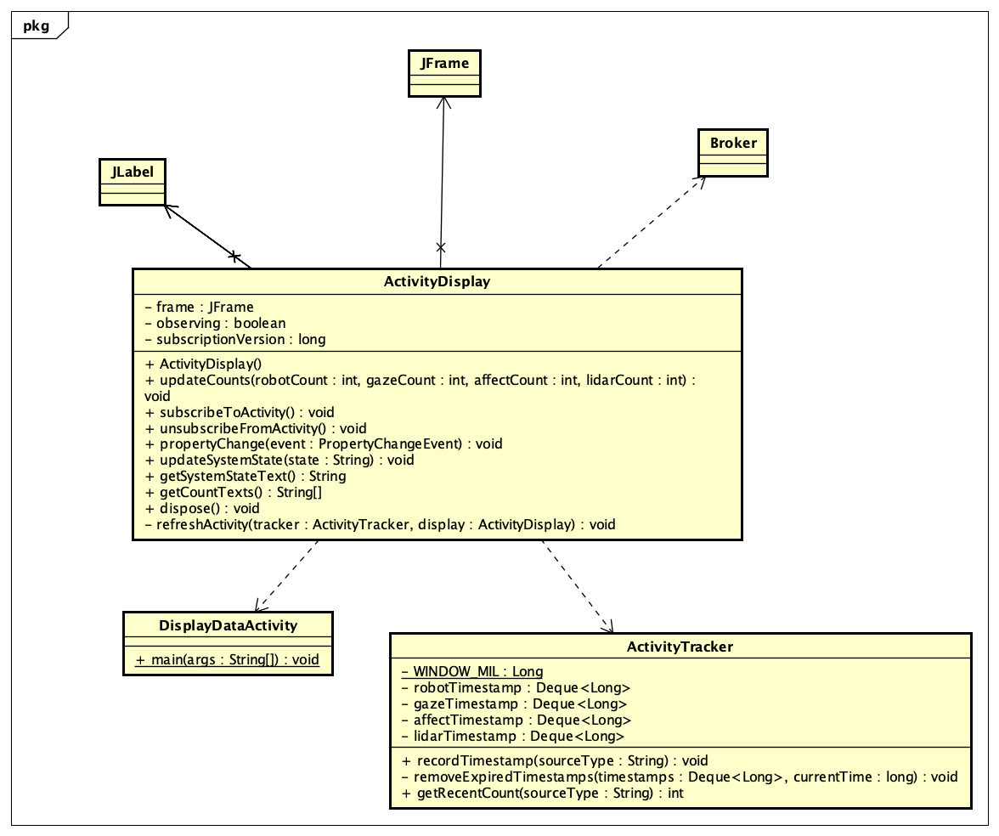

MODULE 6 - DISPLAY RECENT DATA ACTIVITY

Overall

This program/first spring monitors recent message activity from four data sources:
- ROBOT
- GAZE
- AFFECT
- LiDAR

This program also displays the number of messages received from each source during the most recent 60 seconds. Again, the counts update automatically in a Java Swing Window.

In terms of the:

DESIGN

The application uses three main classes
- DisplayDataActivity: receives messages from the provided Broker, creating the tracker and the GUI, and starts the automatic refresh timer.
- ActivityTracker: which stores message timestamps separately for ROBOT, GAZE, AFFECT and LiDAR. Moroever, it also removes the timestamps older than 60 seconds and returns the current count for each of the desired source.
- ActivityDisplay: which creates the Java Swing widnow and updates the four displayed count labels

MESSAAGES use the format:

TYPE, data ... and so on

HOW TO RUN:

1. Build the project
~ mvn compile

2. Run the provided data simulator, TestMonitorData.java
(leave it running)

3. Run DisplayDataActivity.java

and then Run Java: Start TestMonitorData, and then DisplayDataActivity

LocalHost: 5000;

TESTING

Verified behavior:

1) Robot, Gaze, Affect, and LiDAR messages are counted separately.
2) Different source rates produce different displayed counts.
3) New messages increase the appropriate source count.
4) Counts refresh automatically without user interaction.
5) The application continues working while message types are interleaved.
6) When a source stops producing data, its count decreases as messages become older than 60 seconds.
7) When a source resumes sending data, its count increases again.

Spring 3 ----- OBSERVER REFACTORING ------
Our original design was based on 
- receiveing message, recording timestamp, and even using it and sharing it (DisplayDataActivity).
- Duplicating the classification logic and the timer and message recieving loop, and display the Blackboard activity events.

NOW REFACTORING CONTAINS AND AIMS TO ----->
- Mantaining the existing 60-second message count window (ActivityTracker).
- Preserving the existing activity classification (ActivityClassifier)
- Provides the existing property-Change notificiations mechanism. (Blackboard)
- ActivityWindowListener: Removes the display's subscription on the Swing Event thread
- Implementing PropertyChangeListener (Subscriber) to Blackboard.ACTIVITY_STATE that queues observed label updates

---- BUILD and RUN ------

$ mvn test-compile

then;

run the test calpoly.test.spring1.TestMonitorData

and then in a diff terminal

run mvn calpoly.monitor.DisplayDataActivity

--- TESTING -----
Run mvn BlackboardActivityDisplayTest.java test

---- FINALLY -----

$ mvn clean verify

## UML
